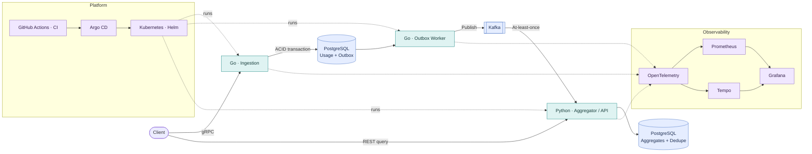

# PolyFlow

PolyFlow is a portfolio project demonstrating a polyglot, event-driven usage metering system with reliable event publication, idempotent aggregation, Kubernetes deployment, GitOps, and end-to-end observability.

## Business case

Simulate a SaaS usage metering platform: tenants submit API usage events; the platform durably accepts them, publishes them asynchronously, aggregates usage, and exposes usage queries. Invoicing and payment processing are out of scope for the MVP.

## Architecture

## Correctness properties

1. Business record and outbox event commit or roll back together.
2. Kafka downtime after durable acceptance does not lose the event.
3. Duplicate delivery does not double-count usage.
4. Aggregate update and processed-event marker commit atomically.
5. Consumer offset is acknowledged only after database commit.
6. Tenant access is authorized and isolated.
7. Performance claims are backed by repeatable measurements.

## Seven-sprint roadmap

| Sprint | Focus | Exit gate |
|---|---|---|
| 1 | Foundations and contracts | Go gRPC and FastAPI health endpoints work; generated code is reproducible |
| 2 | Services and PostgreSQL | Validation, migrations, persistence, idempotency tests pass |
| 3 | Transactional outbox and Kafka | Retry, duplicate delivery, worker crash, and consumer restart tests pass |
| 4 | Docker, Kubernetes, Helm | Reproducible deploy, probes, resource limits, restart recovery |
| 5 | Observability | Trace context spans producer-to-consumer; key metrics and alerts exist |
| 6 | CI/CD, GitOps, security | Automated checks, image scanning, Argo CD sync and drift recovery |
| 7 | Load testing and hardening | Correctness under load, recovery tests, reproducible benchmark report |

## GitHub Project configuration

Create a repository-linked Project named **PolyFlow Engineering Roadmap**.

Recommended fields:
- Status: Todo, In Progress, In Review, Done
- Sprint: Sprint 1 through Sprint 7
- Component: Service A, Outbox Worker, Service B, PostgreSQL, Kafka, API/Contracts, Observability, Kubernetes/Helm, CI/CD/GitOps, Performance/Testing, Documentation
- Priority: High, Medium, Low
- Estimate: number
- Target date: date, optional

Suggested views:
- Board grouped by Status
- Sprint plan grouped by Sprint
- Roadmap timeline using target dates
- Bugs and reliability filtered by bug/testing labels

Suggested labels:
- Sprint: sprint-1 through sprint-7
- Component: service-a, service-b, outbox-worker, kafka, database, api-contracts, observability, kubernetes, gitops, performance
- Work type: feature, bug, testing, documentation, security
- Priority: priority:high, priority:medium, priority:low

Suggested milestones:
1. Sprint 1 — Foundations and contracts
2. Sprint 2 — Services and PostgreSQL
3. Sprint 3 — Transactional outbox and Kafka
4. Sprint 4 — Docker, Kubernetes, and Helm
5. Sprint 5 — Observability
6. Sprint 6 — CI/CD, GitOps, and security
7. Sprint 7 — Load testing and hardening

Choose actual due dates after agreeing on the sprint start date.

## Service acceptance criteria

### Service A — Usage Ingestion
- [ ] Valid usage event is validated and saved with its outbox event in one transaction.
- [ ] Transaction failure leaves neither record committed.
- [ ] Same event ID and same payload is idempotent.
- [ ] Same event ID with a conflicting payload is rejected.
- [ ] Invalid tenant, metric, quantity, or timestamp writes nothing.
- [ ] Kafka being down does not prevent durable acceptance when PostgreSQL is healthy.

### Outbox Worker
- [ ] Pending rows are claimed safely by concurrent workers.
- [ ] Rows are marked published only after Kafka acknowledgement.
- [ ] Failures retry with configured backoff; retryable events are not silently discarded.
- [ ] A crash after publish may cause duplicate delivery but no silent data loss.
- [ ] Graceful shutdown leaves unprocessed rows recoverable.
- [ ] Pending count, oldest event age, retries, and publish errors are observable.

### Service B — Usage Aggregation
- [ ] Events with usage quantities 100, 150, and 50 produce a total of 300.
- [ ] Duplicate delivery does not increment totals twice.
- [ ] Aggregate update and processed-event marker commit atomically.
- [ ] Kafka offset is acknowledged only after database commit.
- [ ] Authorized tenant can query its daily/monthly usage.
- [ ] One tenant cannot read another tenant's usage.
- [ ] Restart preserves correctness.

## Study materials

- Go: [A Tour of Go](https://go.dev/tour/), [Effective Go](https://go.dev/doc/effective_go)
- gRPC/protobuf: [gRPC docs](https://grpc.io/docs/), [proto3 guide](https://protobuf.dev/programming-guides/proto3/)
- Python API: [FastAPI tutorial](https://fastapi.tiangolo.com/tutorial/), [pytest](https://docs.pytest.org/en/stable/)
- PostgreSQL: [Tutorial](https://www.postgresql.org/docs/current/tutorial.html), [transactions](https://www.postgresql.org/docs/current/tutorial-transactions.html)
- Outbox: [Transactional Outbox pattern](https://microservices.io/patterns/data/transactional-outbox.html)
- Kafka: [Kafka documentation](https://kafka.apache.org/documentation/), [Confluent courses](https://developer.confluent.io/courses/)
- Kubernetes: [Kubernetes basics](https://kubernetes.io/docs/tutorials/kubernetes-basics/), [Kind](https://kind.sigs.k8s.io/docs/user/quick-start/), [Helm](https://helm.sh/docs/intro/quickstart/)
- Observability: [OpenTelemetry](https://opentelemetry.io/docs/), [Prometheus](https://prometheus.io/docs/introduction/overview/), [Grafana](https://grafana.com/tutorials/grafana-fundamentals/)
- GitOps/security: [Argo CD](https://argo-cd.readthedocs.io/en/stable/getting_started/), [Trivy](https://trivy.dev/latest/)
- Performance/SRE: [k6](https://grafana.com/docs/k6/latest/), [Google SRE book](https://sre.google/sre-book/table-of-contents/)

## Definition of done

An issue is done when its acceptance criteria are verified, tests are committed, configuration is documented, telemetry supports troubleshooting where relevant, and the README reflects the behavior. Performance targets remain provisional until a baseline is measured.
